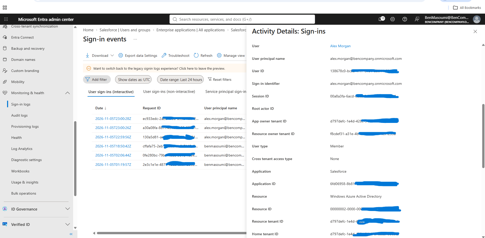

# Salesforce SAML SSO with Microsoft Entra ID

I set up SAML 2.0 Single Sign-On between Microsoft Entra ID and Salesforce Developer Edition to practice integrating a third-party application with Entra ID.

The idea was to have a user sign in to Salesforce using their Microsoft account rather than a separate Salesforce password. Entra ID handles authentication, and Salesforce uses the SAML response to identify the user.

I tested the setup with a cloud-only Entra ID account and successfully signed in to Salesforce.

## Lab Setup

| | |
|---|---|
| Identity Provider | Microsoft Entra ID (Free) |
| Service Provider | Salesforce Developer Edition |
| Protocol | SAML 2.0 |
| Test user | Alex Morgan |
| User matching | Entra UPN / Salesforce Username |
| Provisioning | Manual |

I used my existing Entra tenant and created a Salesforce Developer Edition organization. The Salesforce admin account had the System Administrator profile, which I needed to configure SSO.

## 1. Setting Up Salesforce in Entra ID

I added Salesforce from the Enterprise Application gallery in Entra ID.

`Entra ID > Enterprise Applications > New Application`

Under Properties, I set **Assignment required** to **Yes**, so users need to be assigned to the application before they can sign in through Entra ID.

I assigned my test user, Alex Morgan, to the application.

## 2. SAML Configuration in Entra ID

Under **Single sign-on**, I selected SAML and configured the Salesforce endpoints.

The main settings were:

- **Identifier (Entity ID):** Identifies the Salesforce application.
- **Reply URL (ACS):** Where Salesforce receives the SAML response.
- **Sign-on URL:** Salesforce login URL.

I used the Salesforce SAML metadata to get the correct endpoint values.

For **Attributes & Claims**, I configured the NameID to use `user.userprincipalname`.

This was important because I configured Salesforce to match incoming SAML identities against Salesforce usernames.

I also downloaded the **Federation Metadata XML** from Entra ID. Salesforce uses the identity provider information and signing certificate to validate SAML responses.

## 3. Salesforce SAML Settings

In Salesforce, I went to **Setup > Single Sign-On Settings**, enabled SAML, and imported the federation metadata from Entra ID.

I verified the issuer, Identity Provider Login URL, and certificate.

For user identification, I configured:

- **SAML Identity Type:** Username
- **SAML Identity Location:** NameIdentifier in the Subject

I then went to **My Domain > Authentication Configuration** and enabled the SAML authentication option.

I kept the normal Salesforce Login Form enabled so I could still sign in with the administrator account if needed.

## 4. Matching the User Accounts

I used Alex Morgan as my test user.

In Entra ID, Alex has a User Principal Name (UPN), which is sent as the NameID in the SAML response.

I created a matching user in Salesforce and made sure the Salesforce Username matched the Entra UPN.

The Salesforce account was created manually. I didn't configure automatic user provisioning for this lab.

## 5. Testing SSO

I opened Salesforce in an Incognito window to test the sign-in without using an existing browser session.

The configured SAML login option appeared on the Salesforce login page.

I clicked the SSO option, authenticated using Alex's Microsoft account, and was redirected back to Salesforce.

The login worked, and Salesforce opened Alex's account.

I also checked the sign-in logs in Entra ID and located the Salesforce authentication event for Alex.

### Test Results

| Test | Result |
|---|---|
| Salesforce added as Enterprise Application | Passed |
| Application assignment configured | Passed |
| SAML settings configured on both sides | Passed |
| Entra UPN matched Salesforce Username | Passed |
| Login through Microsoft Entra ID | Passed |
| Salesforce session opened for Alex | Passed |
| Salesforce event found in Entra sign-in logs | Verified |

## Final Notes

The SSO integration is working. Alex can sign in to Salesforce using Entra ID, and Salesforce recognizes the correct user based on the NameID claim.

This lab helped me understand how Enterprise Applications, SAML endpoints, signing certificates, and user identity mapping work together when connecting Entra ID to a third-party application.

For a future lab, I'd like to test access restrictions with unassigned and disabled accounts and look into automatic user provisioning.
